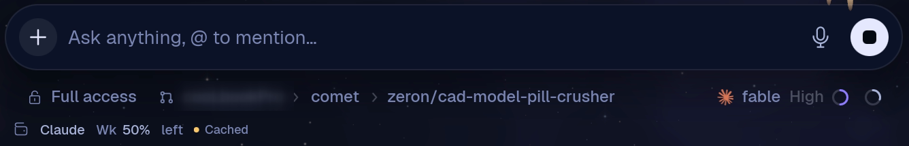
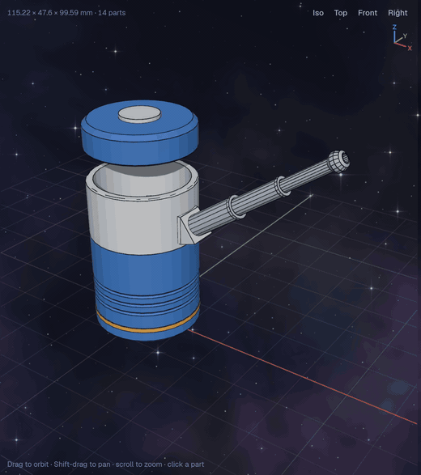
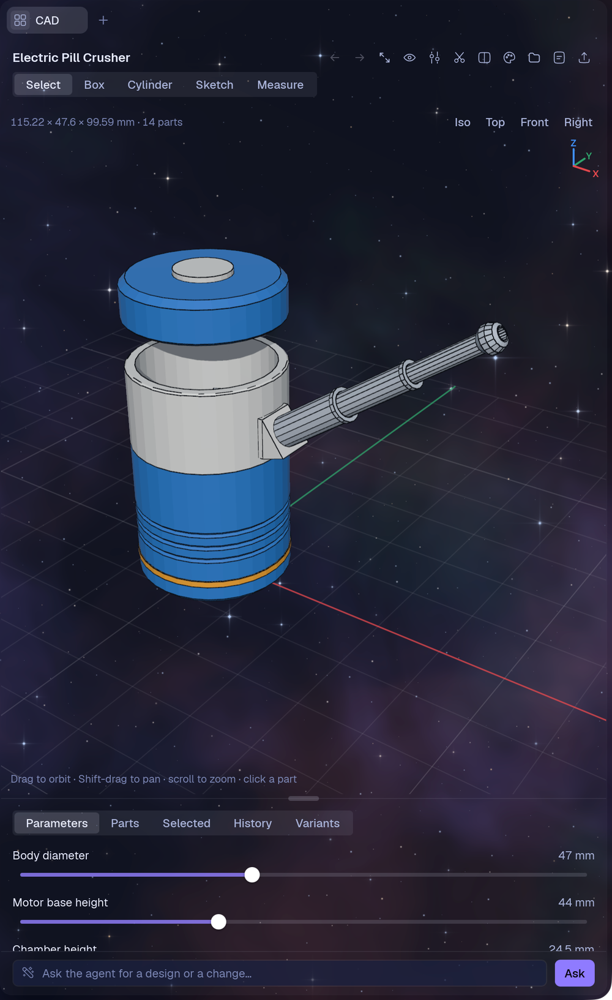
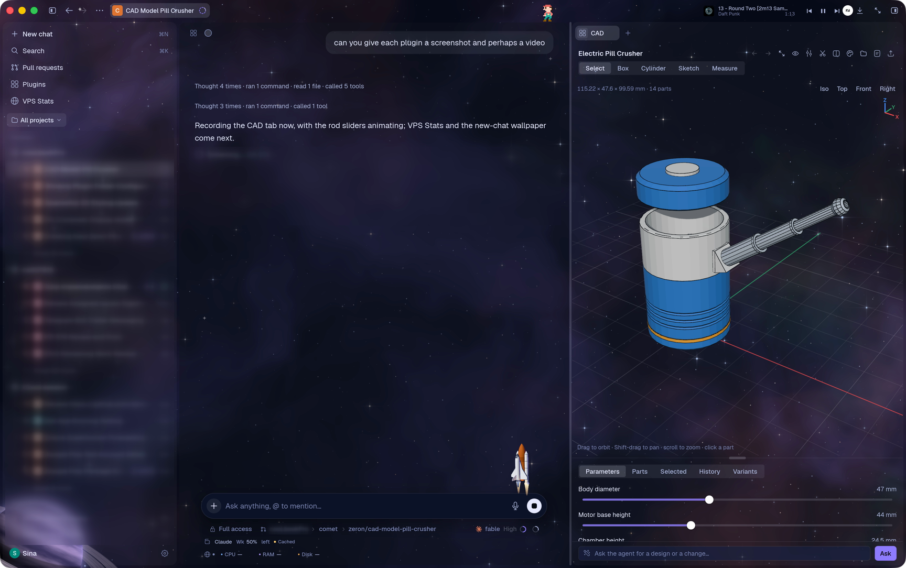
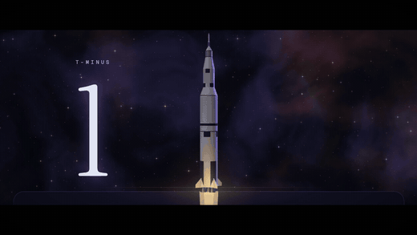
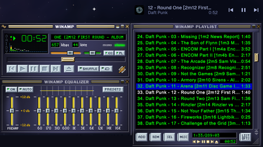
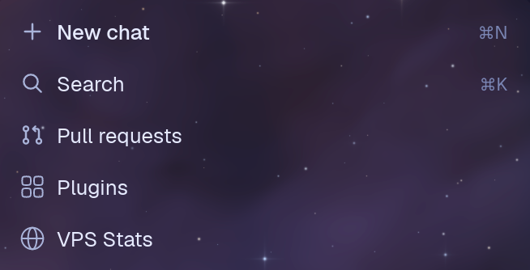

# my-zeron-plugins

some cool zeron plugins for u

Plugins for [Zeron](https://zeron.sh), one folder each. Every folder is a whole plugin: its manifest (`zeron-plugin.json`), its code (Luau, some with a small Python helper), and its own README.

## Installing one

Each plugin installs from its folder's link, for example:

```
https://github.com/SinaKhalili/my-zeron-plugins/tree/main/cad
```

The easiest way is to ask an agent in a Zeron chat: "install the plugin at https://github.com/SinaKhalili/my-zeron-plugins/tree/main/cad". Zeron checks the plugin's signature, then shows you who signed it and what it asks for. Nothing runs until you allow it in Zeron's window.

The plugins are signed with my key, so Zeron refuses a copy whose files were changed. To change one, put your own copy in Zeron's plugins folder and sign it as you: `zeron plugin sign <id>`.

## The plugins

### [Account Usage](account-usage/)

Remaining session and weekly usage for the selected coding account, in Zeron’s bottom bar.



- Folder: `account-usage` · version 1.1.0
- Asks for: `ui.add`, `commands`
- Needs: Python 3

### [CAD](cad/)

Parametric 3D CAD beside your chat: describe a part and the agent models it, then shape it with the mouse, sliders and sketches.





- Folder: `cad` · version 0.1.0
- Asks for: `ui.add`, `panel.tabs`, `compose`, `tools`, `files`

### [Cosmos](cosmos/)

A deep-space look for the whole window: stars and a nebula behind everything, a ringed planet, a rocket on the message box, tonight's moon, and an orbital wallpaper for new chats.



<a href="media/cosmos-trailer.mp4"></a>

▶ [Watch the trailer](media/cosmos-trailer.mp4) (39 seconds, with sound). The voices are NASA's own recordings of Apollo 11.

- Folder: `cosmos` · version 1.0.0
- Asks for: `ui.add`, `ui.change`, `sessions.read`

### [Headamp](headamp/)

A tiny top-bar music player that opens a full retro Winamp deck.



- Folder: `headamp` · version 1.3.1
- Asks for: `ui.add`, `web`, `commands`
- Needs: Python 3, to read a folder of music

### [Pixel Walker](pixel-walker/)

A tiny pixel fellow, joined by a colour-coded walker for each running subagent of the open chat.


- Folder: `pixel-walker` · version 1.1.0
- Asks for: `ui.add`, `sessions.read`, `commands`
- Needs: Python 3

### [Plugin Manager](plugin-manager/)

A Plugins row in the sidebar that opens Settings → Plugins in one click.



- Folder: `plugin-manager` · version 0.1.0
- Asks for: `pages.add`, `navigate`

### [VPS Stats](vps-stats/)

Live CPU, RAM, disk, load, and uptime for your VPS.

- Folder: `vps-stats` · version 1.1.0
- Asks for: `ui.add`, `pages.add`, `commands`
- Needs: `ssh` access to the server, with Python 3 on it

## License

MIT, see [LICENSE](LICENSE). Headamp bundles [Webamp](https://github.com/captbaritone/webamp), also MIT; its license is in `headamp/WEBAMP-LICENSE.txt`.
